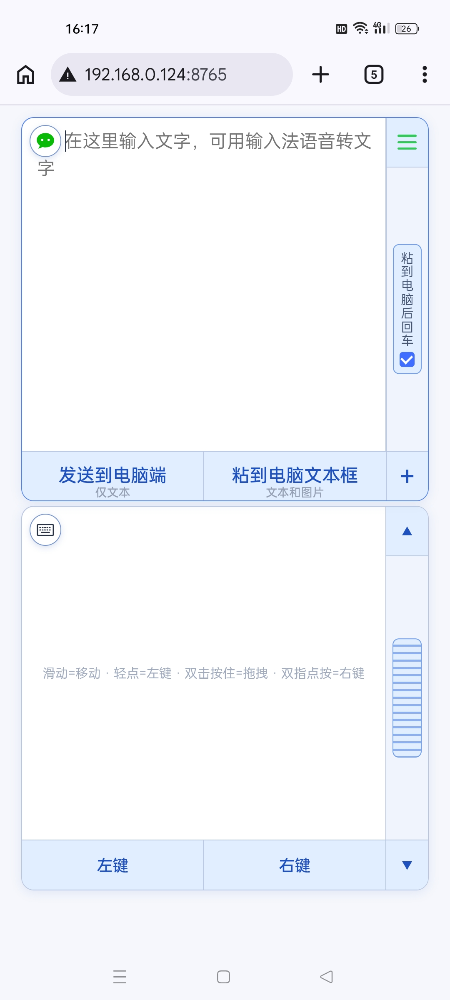
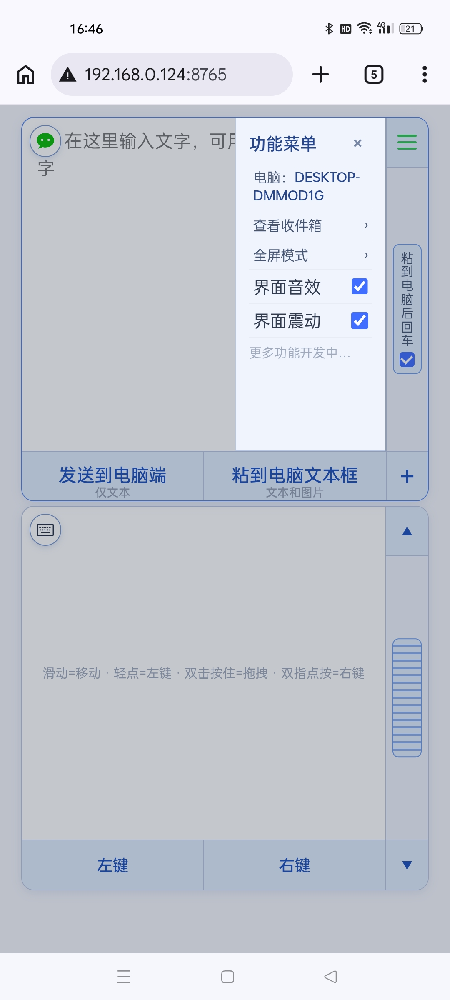
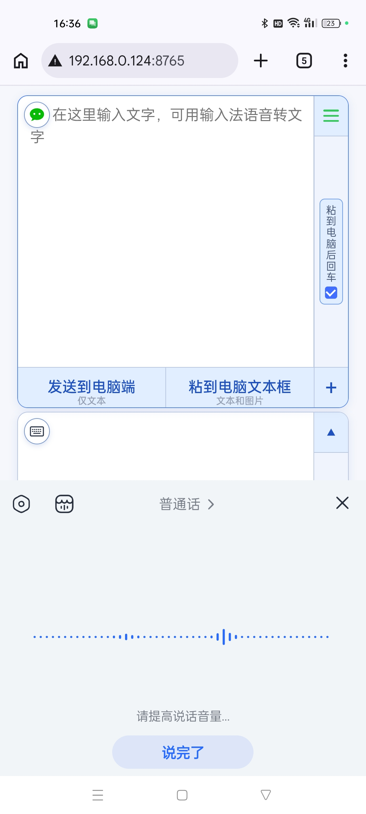
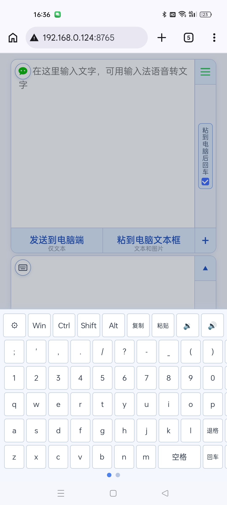
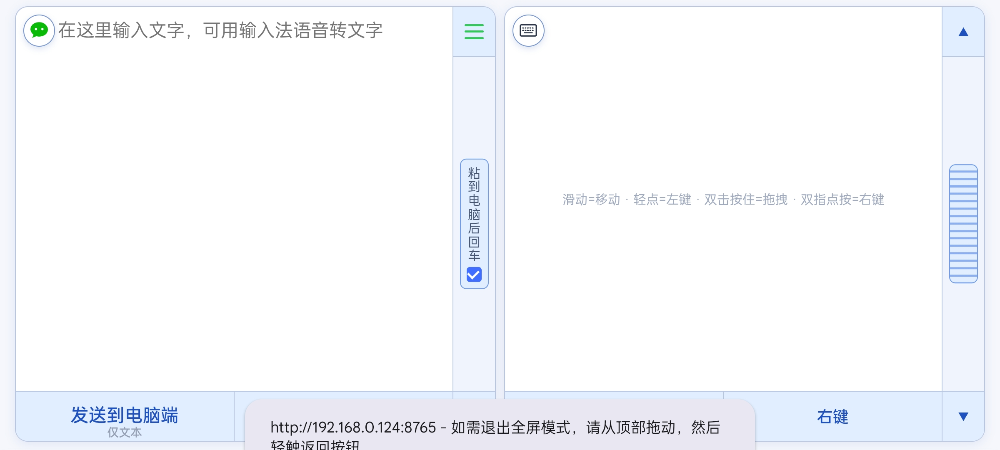
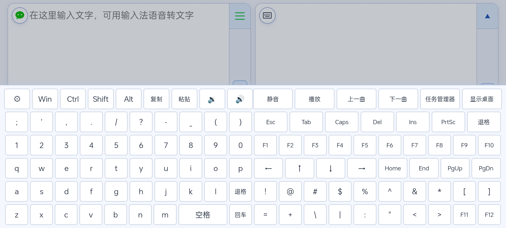
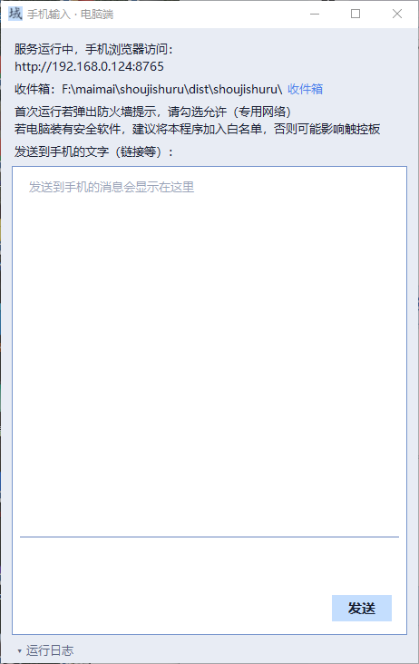

# 域信键鼠（Yuxinjianshu）

手机秒变电脑的键盘 + 触控板 + 文字投递器。

手机浏览器打开电脑上的服务就能用：不用装 App，纯局域网直连，不上外网。

## 能干什么

- **文字投递**：手机上打字，电脑光标处直接粘贴，可勾选"粘贴后自动回车"
- **图片投递**：手机选图发送，直接贴进电脑当前窗口
- **收件箱**：电脑 → 手机反向传文件，手机上查看、预览、下载
- **触控板**：单指移动、轻点左键、双指右键、双指滚动、按住拖拽
- **虚拟键盘**：字母数字、标点符号、F 键、Win/Ctrl/Shift/Alt 修饰键，能按 Win 弹开始菜单、Shift 切中英文
- **电脑端小窗口**：连接状态、聊天消息、运行日志一目了然

## 界面预览

<table>
  <tr>
    <td align="center"><br>文字投递 + 触控板</td>
    <td align="center"><br>功能菜单</td>
    <td align="center"><br>语音转文字</td>
    <td align="center"><br>虚拟键盘</td>
  </tr>
  <tr>
    <td align="center" colspan="2"><br>横屏双面板</td>
    <td align="center" colspan="2"><br>全功能键盘</td>
  </tr>
  <tr>
    <td align="center" colspan="4"><br>电脑端窗口</td>
  </tr>
</table>

## 怎么用

1. 到 [Releases](https://github.com/hjdggyx-lgtm/yuxinjianshu/releases) 下载绿色版压缩包，解压到任意文件夹
2. 双击 `shoujishuru.exe`，桌面窗口显示连接地址（不写注册表、不装服务，整个文件夹拷走就能用）
3. 手机连**同一个 Wi-Fi**，浏览器打开该地址（如 `http://192.168.x.x:8765`）
4. 点左上角三道杠（≡）打开菜单：三道杠红色=未连接，绿色=已连接

## 从源码运行（可选）

```bash
pip install flask pyperclip pyautogui
python shoujishuru.py
```

需要 Windows + Python 3.12+。

## 两句话说明

- 只在局域网内使用，数据不经过任何服务器
- 需要模拟鼠标键盘，若被 360/火绒等拦截，把 `shoujishuru.exe` 加入信任区即可稳定使用

## 致谢

触控板交互参考了开源项目 [remote-touchpad](https://github.com/Unrud/remote-touchpad)，本项目为 Python 单文件独立实现。